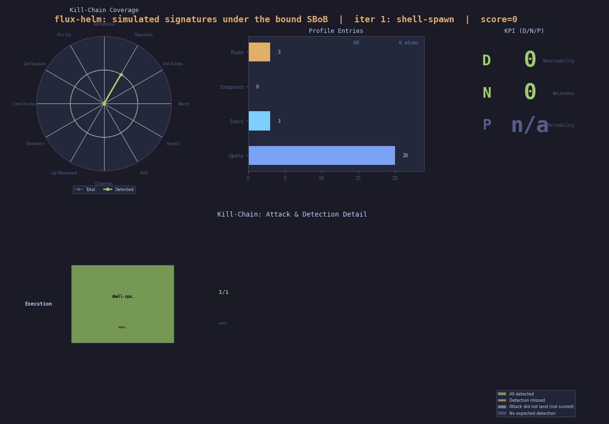
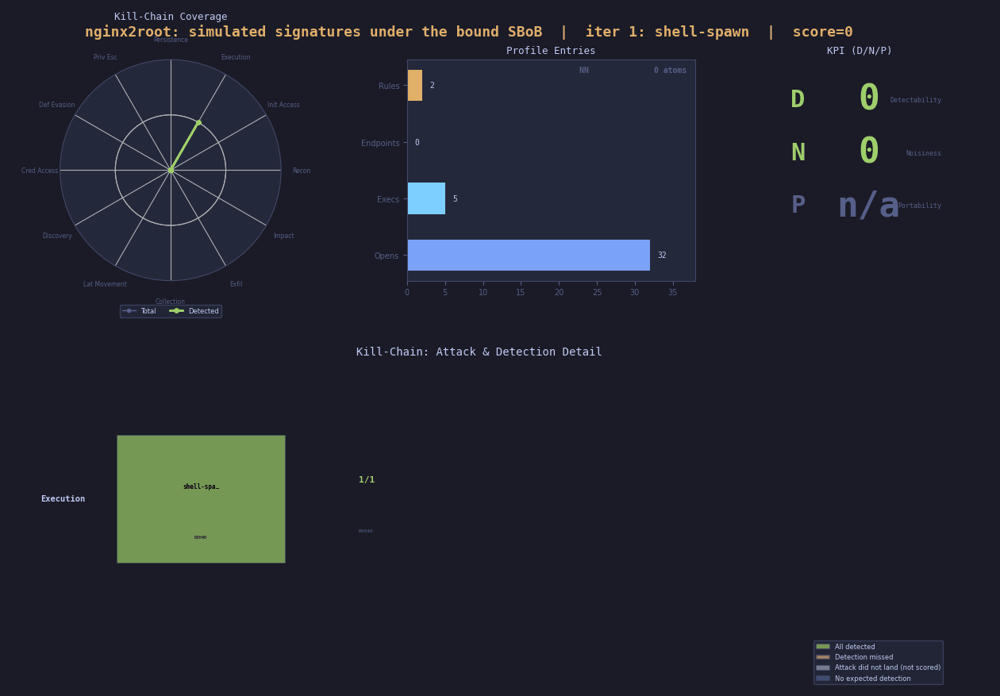

<!--
Maintainer: Constanze Roedig <constanze.roedig@gmail.com>
SPDX-License-Identifier: Apache-2.0
Licensed under the Apache License, Version 2.0; see LICENSE.
All trademarks are expressly reserved.
-->
🥳 We were selected by the eBPF Foundation for their [Community& Advocacy Fellowship](https://ebpf.foundation/ebpf-foundation-announces-2026-community-advocacy-fellowship-recipients/)

🚨 Newly released: the counterpart [Sovereign-SOC-Chart](https://github.com/k8sstormcenter/soc/blob/main/skaffold.yaml) that contains the (alpha) runtime security stack, for which this tool is built.

The draft spec maybe found [here](https://github.com/k8sstormcenter/sbob-spec/blob/main/spec/sbob-v0.2.1.md) 

### 🗺️ Roadmap — coming soon

| | Feature | When |
|---|---|---|
| 1 | MCP server: produce an SBOB for your own application | soon |
| 2 | Signature fragment release of node-agent | ~January 2027 (fork and open PR to upstream) |
| 3 | Auto-suggestion of SBOBs from discovery in a live cluster | TBD |

# Software Bill of Behavior SBOB 

[](https://scorecard.dev/viewer/?uri=github.com/k8sstormcenter/bob) [](https://www.bestpractices.dev/projects/16510)

Imagine a software vendor distills all their knowledge of their own testing into a standard file and ships it `with each update` . Just like a Container Package-Insert (Packungsbeilage) 📦📃🩻


An SBOB is a profile that provides contrast between intended benign and malicious runtime behaviors. 

It's understood to be an abstraction of linux kernel level behavior to express `intent` across systems:

- **to explicitly test for false-negatives**: each attack type can be verified as 'blind' or 'detectable'
- **for continuous anomaly detection at runtime**: allows end-users to calibrate their Detection/Reponse 

  

 🚨GOAL for 2027: 90 percent of all CNCF projects (that run on linux-k8s) get an SBOB 


`scale is hard in security` and thats the main reason why a solid runtime expectation `needs` to be distributed from the entity that has the knowledge of the implementation details AND the test cases AND the tooling AND the requirements.


**Trademark:** Bill of Behavior is a registered trademark by Constanze Roedig, all rights reserved  


### Stay informed when more applications get SBOBs
Subscribe to the newsletter [https://billofbehavior.com](https://fusioncore.kit.com/86141f7462), follow us on [Linkedin](https://www.linkedin.com/in/croedig/), or talk to us on [slack](https://join.slack.com/t/k8sstorm/signup) 


### Format/Spec
[Specification](https://billofbehavior.com/bob/docs/spec/) for the [Kubescape reference implementation](https://kubescape.io/docs/operator/bill-of-behavior/).


## Try it out in a lab with a k3s and a k8s
Public again on [Iximiuz Labs](https://labs.iximiuz.com/courses/bill-of-behaviour-c070da3a/1vendor/lesson-1) 


## Does your application have a good SBoB?

```mermaid
flowchart LR
    app(["Your application<br/>as Kubernetes manifests"]):::bring
    traffic(["Its usual traffic<br/>a client doing what users do"]):::bring
    learn["Learn<br/>what it executes,<br/>opens, connects to"]:::tool
    gen["Generalize<br/>allow list + subtract list<br/>for its ecosystem"]:::tool
    replay["Usual traffic again,<br/>SBoB bound"]:::tool
    sim["Simulate<br/>common CVE types<br/>of that ecosystem"]:::tool
    kpi{"D · N · P<br/>all zero?"}:::outcome
    sbob(["An SBoB to ship<br/>with your release"]):::outcome
    fix(["Improve the traffic,<br/>run again"]):::bring

    app --> learn
    traffic --> learn
    learn --> gen --> replay
    replay -->|"must stay silent"| sim
    sim -->|"every step must alert"| kpi
    kpi -->|yes| sbob
    kpi -->|no| fix

    classDef bring fill:#e8f1ff,stroke:#3b6fd4,stroke-width:2px,color:#12284c
    classDef tool fill:#fff4d6,stroke:#c98a00,stroke-width:2px,color:#3d2c00
    classDef outcome fill:#e3f6e8,stroke:#2e8b57,stroke-width:2px,color:#0f3d24
```



Blue is yours, yellow is bobctl, green is the result.

- **You bring the usual traffic.** Only you know what normal looks like: a client that reads, writes, logs in, runs the backup.
- **bobctl finds the ecosystem** (native code, JVM, Node.js, Go, PHP) and writes the SBoB: a broad allow list, and a subtract list of what stays denied.
- **bobctl simulates the common CVE types of that ecosystem**: a shell started by the server, a download tool, a credential file read. Stand-ins only; nothing is exploited.
- **D, N, P**: steps not detected, alerts under your usual traffic, extra alerts on a second cluster. All zero means the SBoB is good.

| | |
|---|---|
|  | **An application nobody prepared for.** bobctl was told only that MongoDB is a database and found the rest itself. |
|  | **Checked against a real exploit.** For nginx the same SBoB also faces a published exploit, and the result is compared with the simulation. |

The GIF at the top of this page is Flux's helm-controller. In each GIF: left, what was tried and detected; middle, the SBoB (allow list as bars, subtract list below); right, D, N and P.

## Using bobctl

```bash
curl -fsSL -o bobctl https://github.com/k8sstormcenter/bob/releases/download/v0.1.29/bobctl-linux-amd64
chmod +x bobctl && sudo mv bobctl /usr/local/bin/
```
Release binaries are cosign-signed (`bobctl-linux-amd64.sigstore.json`).

| You want to | Run |
|---|---|
| fetch what the agent learned | `bobctl get <profile> -n NS -o yaml > profiles/app.yaml` |
| turn it into an SBoB | `bobctl generalize -d profiles/ --sbob <label>-<container> -n NS -o sbob.yaml` |
| check that the agent will accept it | `bobctl validate --file sbob.yaml` |
| put it on the cluster | `bobctl apply -f sbob.yaml -n NS`, then label the pod template `kubescape.io/user-defined-profile: <label>` |
| see what changed between two versions | `bobctl diff --file-a old.yaml --file-b new.yaml` |
| check recorded alerts against it, offline | `bobctl replay -p sbob.yaml -a alerts/` |
| run a suite of your own against it | `bobctl simulate --suite suite.yaml -n NS` |

The simulation of common CVE types and the three numbers run in this repository's `Contrast` workflow; its steps are not published. `bobctl --help` lists more verbs. They maintain the examples here, and you do not need them to start.

### Examples

| Path | What |
|---|---|
| `example/contrast/` | SBoBs the `Contrast` workflow produced, one directory per application |
| `example/flux/deploy/` | the Flux controllers' SBoBs |
| `example/github-runner/` | CI runner profiles |
| `example/php2shell/`, `example/php2shell-wordpress/` | the two applications that are also tested with a real exploit |
