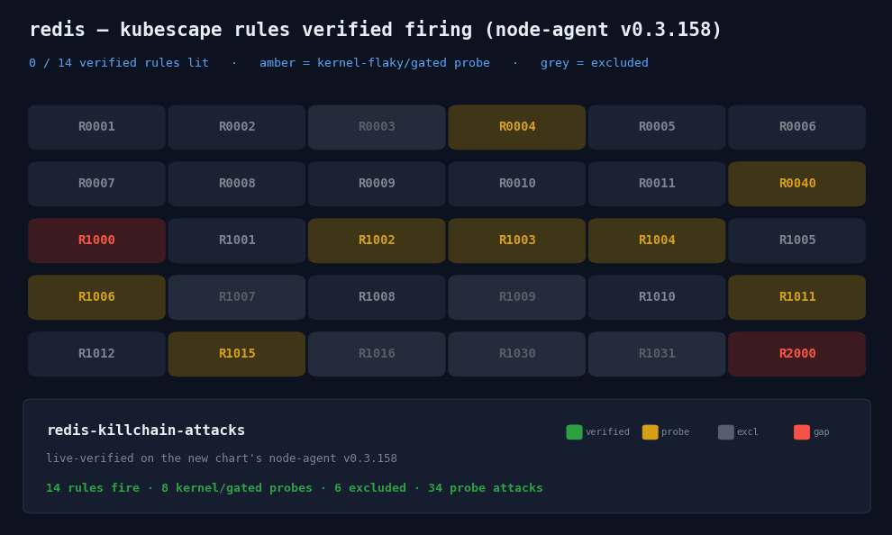

<!--
Maintainer: Constanze Roedig <constanze.roedig@gmail.com>
SPDX-License-Identifier: Apache-2.0
Licensed under the Apache License, Version 2.0; see LICENSE.
All trademarks are expressly reserved.
-->
🥳 We were selected by the eBPF Foundation for their [Community& Advocacy Fellowship](https://ebpf.foundation/ebpf-foundation-announces-2026-community-advocacy-fellowship-recipients/)

🚨 Newly released: the counterpart [Sovereign-SOC-Chart](https://github.com/k8sstormcenter/soc/blob/main/skaffold.yaml) that contains the (alpha) runtime security stack, for which this tool is built.

# Software Bill of Behavior SBOB 

[](https://scorecard.dev/viewer/?uri=github.com/k8sstormcenter/bob)

Imagine a software vendor distills all their knowledge of their own testing into a standard file and ships it `with each update` . Just like a Container Package-Insert (Packungsbeilage) 📦📃🩻


An SBOB is a profile that provides contrast between intended benign and malicious runtime behaviors. 

It's understood to be an abstraction of linux kernel level behavior to express `intent` across systems:

- **to explicitly test for false-negatives**: each attack type can be verified as 'blind' or 'detectable'
- **for continuous anomaly detection at runtime**: allows end-users to calibrate their Detection/Reponse 

  

 🚨GOAL for 2027: 90 percent of all CNCF projects (that run on linux-k8s) get an SBOB 


`scale is hard in security` and thats the main reason why a solid runtime expectation `needs` to be distributed from the entity that has the knowledge of the implementation details AND the test cases AND the tooling AND the requirements.


**Trademark:** Bill of Behavior is a registered trademark by Constanze Roedig, all rights reserved  


### Stay informed when more applications get SBOBs
Subscribe to the newsletter [https://billofbehavior.com](https://fusioncore.kit.com/86141f7462), follow us on [Linkedin](https://www.linkedin.com/in/croedig/), or talk to us on [slack](https://join.slack.com/t/k8sstorm/signup) 


### Format/Spec
[Specification](https://billofbehavior.com/bob/docs/spec/) for the [Kubescape reference implementation](https://kubescape.io/docs/operator/bill-of-behavior/).


## Try it out in a lab with a k3s and a k8s
Public again on [Iximiuz Labs](https://labs.iximiuz.com/courses/bill-of-behaviour-c070da3a/1vendor/lesson-1) 


## TLDR — bobctl

```bash
curl -fsSL -o bobctl https://github.com/k8sstormcenter/bob/releases/download/v0.1.14/bobctl-linux-amd64
chmod +x bobctl && sudo mv bobctl /usr/local/bin/
make kubescape && make alertmanager
```
Release binaries are cosign-signed (`bobctl-linux-amd64.sigstore.json`).

### Generate an SBoB

```bash
# N learned profiles → one portable SBoB (CI/CD preset, drop L7 endpoints)
bobctl generalize -d profiles/ --type cicd --sbob cp-app -n NS --drop-endpoints -o cp-app.yaml

# runner family: base + per-image overlays, rebuilt by the harness
bobctl harden --file sbobs/runner-family/runner.yaml --ecosystems all --preset-egress cicd --recover-veto --in-place
bobctl harden --file sbobs/runner-family/runner-overlay-nnf-runner-noble-runner.yaml --fold-toolchain-verbs --in-place
harness/compose.sh                       # base + overlays + ioc-overlays/*.yaml → deploy/*-runner.yaml

# union IoC subtract fragments (agent evaluates match(allow) && !match(subtract))
bobctl compose --name cp-app cp-app.yaml ioc-overlays/*.yaml -o cp-app.deploy.yaml

# drop L7 endpoints from a shipped SBoB
bobctl strip-endpoints --file cp-app.yaml --in-place
```

### Test an SBoB

```bash
# contrast a learned profile against its app TYPE envelope
bobctl contrast --profile cp-app.yaml --type web-app --strict

# run the attack + functional suite against the target
bobctl simulate --suite example/<app>-attacks.yaml -n NS --service <svc> --service-port <port> --format table

# score a shipped SBoB offline against alerts recorded on another build (<RULE>.jsonl per dir)
bobctl replay -p cp-app.yaml -a alerts/ --type cicd

# recommend CollapseConfig for noisy paths; --apply writes the cluster-wide CRD
bobctl collapse --namespaces NS
bobctl collapse --namespaces NS --apply
```

### Sign

```bash
bobctl sign --profile cp-app --key key.hmac -o cp-app.signed.json
bobctl verify --profile cp-app --key key.hmac
```

### Verbs

`learn` `install` `reinstall` `suggest` `onboard` · `generalize` `compose` `base` `harden`
`collapse` `strip-endpoints` `portable` `translate` `seccomp` · `contrast` `simulate` `test`
`replay` `verify` `report` `diff` · `tune` `exclusions` `portability-probe` `overlay` ·
`sign` `apply` `deploy` `get` `validate` `version`

### Examples

| path | suite |
|---|---|
| `example/github-runner` | `../github-runner-attacks.yaml`; `ioc-overlays/` → `spec.subtract` |
| `example/php2shell` | `ci-php2shell-k3s-demo` / `-twin` / `-rules` |
