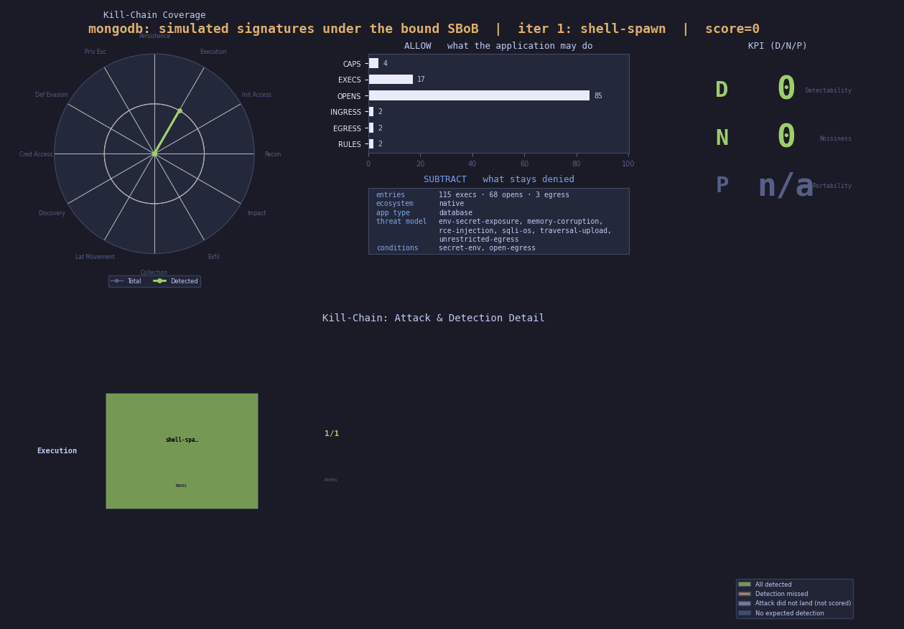

<!--
Maintainer: Constanze Roedig <constanze.roedig@gmail.com>
SPDX-License-Identifier: Apache-2.0
Licensed under the Apache License, Version 2.0; see LICENSE.
All trademarks are expressly reserved.
-->
🥳 We were selected by the eBPF Foundation for their [Community& Advocacy Fellowship](https://ebpf.foundation/ebpf-foundation-announces-2026-community-advocacy-fellowship-recipients/)

🚨 Newly released: the counterpart [Sovereign-SOC-Chart](https://github.com/k8sstormcenter/soc/blob/main/skaffold.yaml) that contains the (alpha) runtime security stack, for which this tool is built.

The draft spec maybe found [here](https://github.com/k8sstormcenter/sbob-spec/blob/main/spec/sbob-v0.3.1.md) , this repo is using `simulated attacks only`, so if you see a CNCF application getting a detection, that means we could detect the `weakness`, not that it `has` a weakness. This is not a pen-test-tool!

### 🗺️ Roadmap — coming soon

| | Feature | When |
|---|---|---|
| 1 | MCP server: produce an SBOB for your own application | soon |
| 2 | Signature fragment release of node-agent | ~January 2027 (fork and open PR to upstream) |
| 3 | Auto-suggestion of SBOBs from discovery in a live cluster | TBD |

# Software Bill of Behavior SBOB 

[](https://scorecard.dev/viewer/?uri=github.com/k8sstormcenter/bob) [](https://www.bestpractices.dev/projects/16510)

Imagine a software vendor distills all their knowledge of their own testing into a standard file and ships it `with each update` . Just like a Container Package-Insert (Packungsbeilage) 📦📃🩻


An SBOB is a profile that provides contrast between intended benign and malicious runtime behaviors. 

It's understood to be an abstraction of linux kernel level behavior to express `intent` across systems:

- **to explicitly test for false-negatives**: each attack type can be verified as 'blind' or 'detectable'
- **for continuous anomaly detection at runtime**: allows end-users to calibrate their Detection/Reponse 

  

 🚨GOAL for 2027: 90 percent of all CNCF projects (that run on linux-k8s) get an SBOB 


`scale is hard in security` and thats the main reason why a solid runtime expectation `needs` to be distributed from the entity that has the knowledge of the implementation details AND the test cases AND the tooling AND the requirements.


**Trademark:** Bill of Behavior is a registered trademark by Constanze Roedig, all rights reserved  


### Stay informed when more applications get SBOBs
Subscribe to the newsletter [https://billofbehavior.com](https://fusioncore.kit.com/86141f7462), follow us on [Linkedin](https://www.linkedin.com/in/croedig/), or talk to us on [slack](https://join.slack.com/t/k8sstorm/signup) 


### Format/Spec
[Specification](https://billofbehavior.com/bob/docs/spec/) for the [Kubescape reference implementation](https://kubescape.io/docs/operator/bill-of-behavior/).


## Does your application have a good SBoB?

```mermaid
flowchart LR
    app(["Your application<br/>as Kubernetes manifests"]):::bring
    traffic(["Its usual traffic<br/>a client doing what users do"]):::bring
    learn["Learn<br/>what it executes,<br/>opens, connects to"]:::tool
    gen["Generalize<br/>allow list + subtract list<br/>for its ecosystem"]:::tool
    replay["Usual traffic again,<br/>SBoB bound"]:::tool
    sim["Simulate<br/>common CVE types<br/>of that ecosystem"]:::tool
    kpi{"D · N · P<br/>all zero?"}:::outcome
    sbob(["An SBoB to ship<br/>with your release"]):::outcome
    fix(["Improve the traffic,<br/>run again"]):::bring

    app --> learn
    traffic --> learn
    learn --> gen --> replay
    replay -->|"must stay silent"| sim
    sim -->|"every step must alert"| kpi
    kpi -->|yes| sbob
    kpi -->|no| fix

    classDef bring fill:#e8f1ff,stroke:#3b6fd4,stroke-width:2px,color:#12284c
    classDef tool fill:#ffffff,stroke:#57606a,stroke-width:2px,color:#1f2328
    classDef outcome fill:#e3f6e8,stroke:#2e8b57,stroke-width:2px,color:#0f3d24
```



Blue is yours, white is bobctl, green is the result.

- **You bring the usual traffic.** Only you know what normal looks like: a client that reads, writes, logs in, runs the backup.
- **bobctl finds the ecosystem** (native code, JVM, Node.js, Go, PHP) and writes the SBoB: a broad allow list, and a subtract list of what stays denied.
- **bobctl simulates the common CVE types of that ecosystem**: a shell started by the server, a download tool, a credential file read. Stand-ins only; nothing is exploited.
- **D, N, P**: steps not detected, alerts under your usual traffic, extra alerts on a second cluster. All zero means the SBoB is good.

| | |
|---|---|
|  | **An application nobody prepared for.** bobctl was told only that MongoDB is a database and found the rest itself. |
|  | **A web server written in C.** nginx serving static files over TLS, under the same check. |

The GIF at the top of this page is Flux's helm-controller. In each GIF: left, what was tried and detected; middle, the SBoB (allow list as bars, subtract list below); right, D, N and P.

## Seven stories this is built for

The people are invented. Each story ends with what works today and what does not yet.

**1. Release day.** Ada maintains a message broker. Before she tags a release she wants to know whether the new version does anything the last one did not: a program it starts, a file it opens, a peer it contacts. She learns an SBoB for the release candidate and compares it with the one she shipped: `bobctl diff --file-a v1.yaml --file-b v2.yaml`. Every new line is either a feature she can name or something to look at before the tag. The diff answers "did the behaviour change", not "is this release safe": between PHP 8.4.26 and 8.4.27, which fixed a remote code execution, it is empty.
*Works today, by hand. Not yet: a ready-made check for her own CI.*

**2. A new advisory lands.** Ben maintains a web server written in C. A memory-corruption report comes in. He cannot try the bug in every deployment, but he can ask what an intruder would do next and whether an SBoB would notice. The Contrast summary lists his project's own advisories by kind, the simulated steps that stand in for what follows each kind, and how many were detected. It also says which kinds nothing stands in for: an authentication bug or a denial of service leaves nothing in the container to see.
*Arrives in the run summary with the next update of the Contrast workflow.*

**3. What should I change?** Chen ships a container image. The summary section "What this container offered the simulated intruder" lists the steps that could run in her image and, for each group, the one setting that would have kept them from running: an image without a shell, a NetworkPolicy on egress, a read-only root filesystem. It removes a tool from an intruder's hands, not the bug that let them in, and not every hint fits every image: a PHP or Python application cannot ship without its interpreter.
*Arrives in the run summary with the next update of the Contrast workflow.*

**4. The backup job.** Dara operates a database. Her SBoB should describe the database, not the benchmark someone ran while it was learned. Her nightly dump must not alert either. So an SBoB comes in two parts: a base with the application's own behaviour, and an overlay with what backup, dump and check commands add. Dara composes the overlay in (`bobctl compose base.yaml operations.yaml --name …`) because she runs those jobs. A team that does not run them leaves it out, and gets an alert when someone starts a dump.
*In progress: bobctl can split a profile this way; the examples here are still one file each.*

**5. A controller without a shell.** Emil maintains a Kubernetes controller written in Go, in an image that holds nothing but the binary. Most simulated steps need a shell, so they cannot run there, and his summary says "offline only": the SBoB was checked against recorded events, not by a step in the container. What matters for him is the controller's own reach: what it can be made to connect to, and what its service account may do.
*Planned: steps performed through the controller's own resources.*

**6. I already have tests.** Finn has an end-to-end suite and does not want to write traffic twice. The usual traffic is any client that does what users do and prints one line per round. His suite can be that client.
*Works today, by hand: [`example/nats/traffic.yaml`](example/nats/traffic.yaml) shows the shape.*

**7. Software nobody prepared.** Greta runs a CNCF project this repository has no simulation, no path list and no traffic for. She follows the [NATS walkthrough](example/nats/README.md): install, learn for eight minutes, generalize, bind, and check that her usual traffic stays silent while something foreign alerts. bobctl recognises the language from the binary and writes the allow list and the subtract list for it.
*Works today with bobctl v0.1.30. Not included: the simulation of common CVE types, which runs only in this repository's `Contrast` workflow.*

## Using bobctl

```bash
curl -fsSL -o bobctl https://github.com/k8sstormcenter/bob/releases/download/v0.1.30/bobctl-linux-amd64
chmod +x bobctl && sudo mv bobctl /usr/local/bin/
```
Release binaries are cosign-signed (`bobctl-linux-amd64.sigstore.json`). Versions are currently being published in rapid succession, verbs and functionality are changing.

| You want to | Run |
|---|---|
| fetch what the agent learned | `bobctl get <profile> -n NS -o yaml > profiles/app.yaml` |
| turn it into an SBoB | `bobctl generalize -d profiles/ --sbob <label>-<container> -n NS -o sbob.yaml` |
| check that the agent will accept it | `bobctl validate --file sbob.yaml` |
| put it on the cluster | `bobctl apply -f sbob.yaml -n NS`, then label the pod template `kubescape.io/user-defined-profile: <label>` |
| see what changed between two versions | `bobctl diff --file-a old.yaml --file-b new.yaml` |
| check recorded alerts against it, offline | `bobctl replay -p sbob.yaml -a alerts/` |
| run a suite of your own against it | `bobctl simulate --suite suite.yaml -n NS` |

The simulation of common CVE types and the three numbers run in this repository's `Contrast` workflow; its steps are not published. `bobctl --help` lists more verbs. They maintain the examples here, and you do not need them to start.

### Examples

| Path | What |
|---|---|
| `example/argo/`, `example/cert-manager/`, `example/cloudnative-pg/`, `example/distribution/`, `example/envoy/`, `example/falco/`, `example/flux/`, `example/keycloak/`, `example/opentelemetry/`, `example/strimzi/`, `example/zot/` | SBoBs the `Contrast` workflow produced, one directory per CNCF project |
| `example/contrast/` | SBoBs the `Contrast` workflow produced for all other software, one file per application |
| `example/nats/` | a walkthrough for an application nobody prepared: from an empty cluster to a bound SBoB for NATS, with the public bobctl only |
| `example/php2shell/`, `example/php2shell-wordpress/` | the two applications that are also tested with a real exploit as shown at [KubeConNA](https://www.youtube.com/watch?v=FMKW3oa5g5g) |
